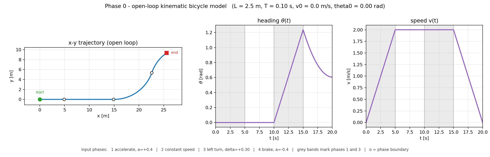
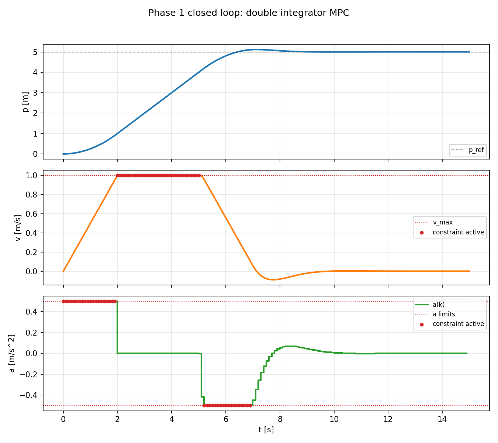
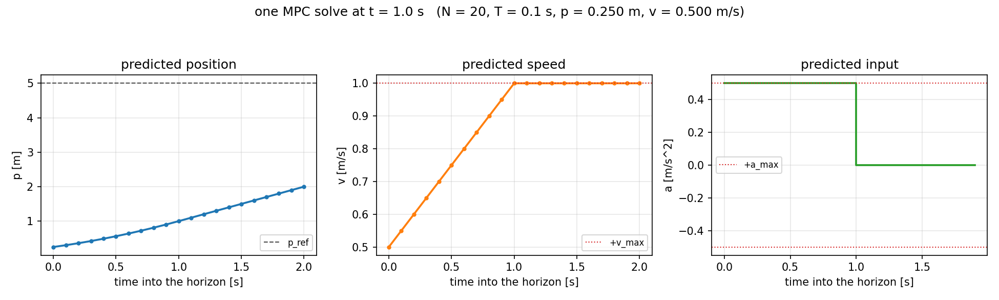
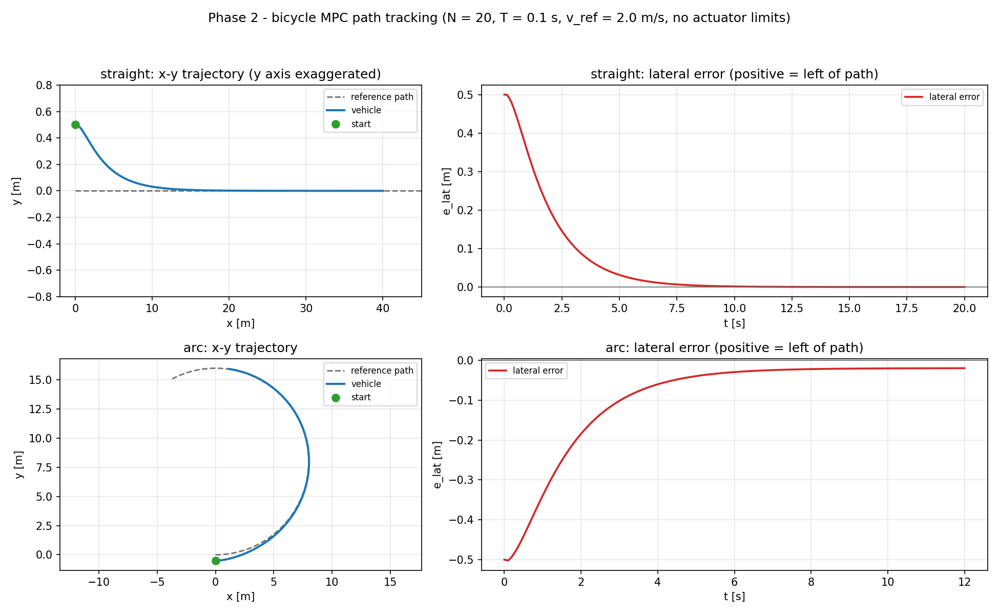
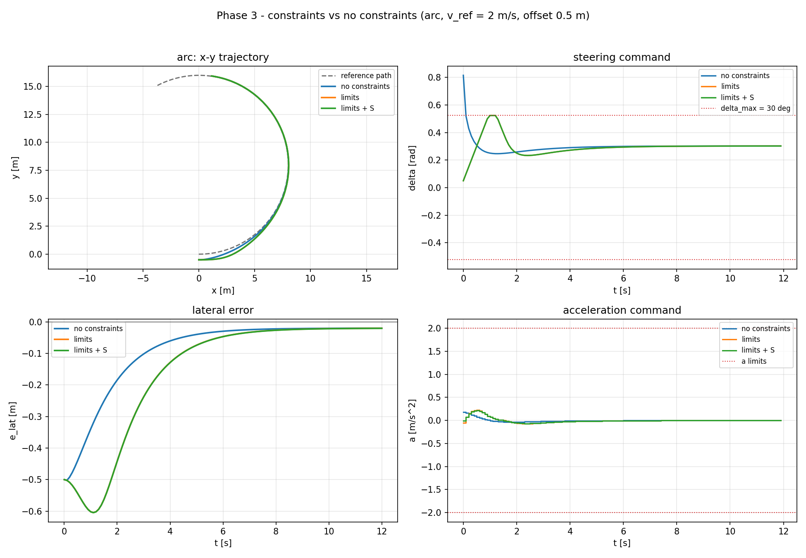
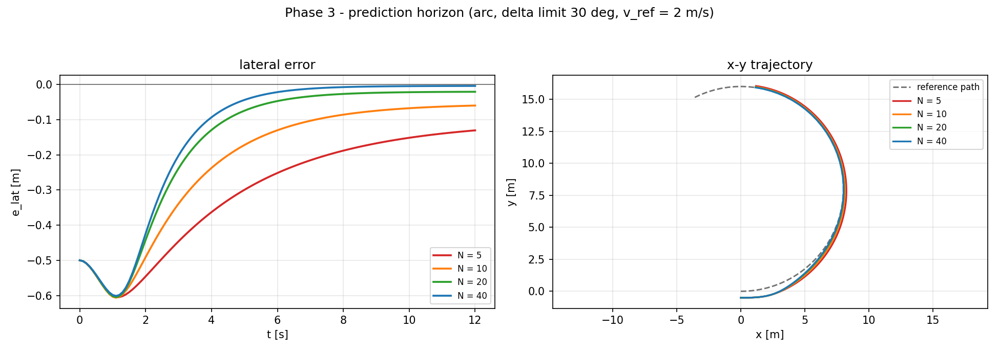
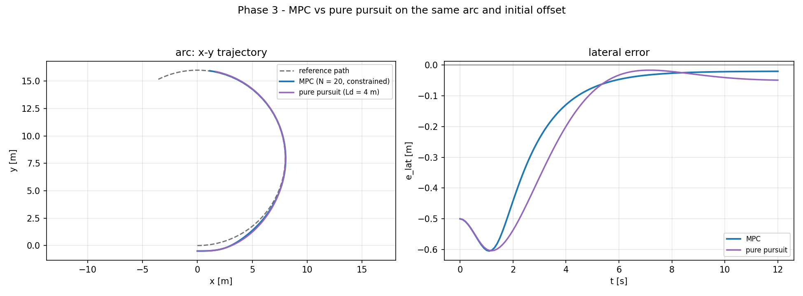
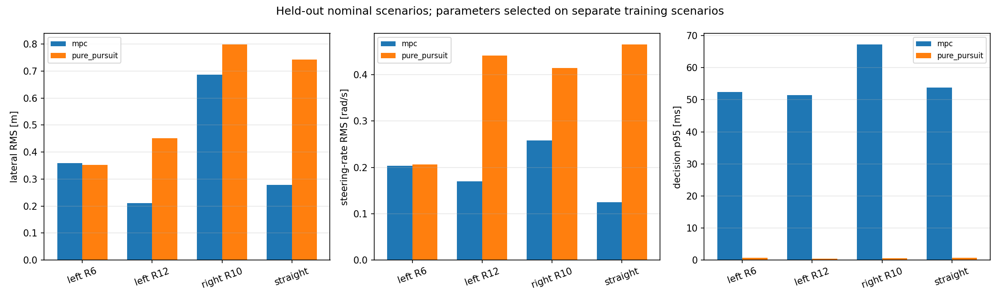

# mpc-path-tracking

Model Predictive Control (MPC) for path tracking with a kinematic bicycle
model, implemented from scratch in Python and kept small enough that every line
can be inspected and studied.

**Status:** runnable educational implementation. Code verification is complete for
the documented scenarios; the owner's learning notes and personal acceptance
remain in progress (see [understanding status](docs/understanding.md)).

The project is a guided exercise: build a working, reproducible MPC, understand
what each part of the problem formulation does, and report the results
honestly. Every figure and number in `docs/results.md` is produced by the
scripts in this repository.

## What is implemented

| Phase | Content | Command |
|---|---|---|
| 0 | kinematic bicycle model, open-loop simulation, sanity tests | `python experiments/00_open_loop.py` |
| 1 | linear MPC for a double integrator (QP, cvxpy + OSQP) | `python experiments/01_double_integrator_mpc.py` |
| 2 | bicycle MPC path tracking on a line and an arc (NLP, CasADi + IPOPT) | `python experiments/02_path_tracking.py` |
| 3 | limits, input-change penalty, horizon study, pure-pursuit baseline | `python experiments/03_constraints.py` etc. |
| 4 | tests, documentation and reproducibility | `python experiments/run_all.py` |
| Extended study | train/test tuning, model mismatch, noise, delay | `python experiments/06_benchmark.py` |
| Sampling study | fixed physical horizon and rate limit | `python experiments/07_sampling.py` |

## Model

Kinematic bicycle model, reference point at the rear-axle centre:

    state  X = [x, y, theta, v]^T      input  u = [a, delta]^T

    x_dot     = v * cos(theta)
    y_dot     = v * sin(theta)
    theta_dot = (v / L) * tan(delta)
    v_dot     = a

discretised with forward Euler, `X(k+1) = X(k) + T * f(X(k), u(k))`.

Conventions: `theta` is measured counter-clockwise from the world +x axis, a
straight reference has `theta_ref = 0`, `delta > 0` steers left, SI units
(m, rad, s), `L = 2.5 m`, `T = 0.1 s`.

The equations, weights and assumptions are collected in [docs/model.md](docs/model.md).
It includes the existing learning reference with its provenance clearly marked;
it is not presented as the owner's completed personal explanation.
The MPC follows a time-indexed trajectory; lateral path error is the reported metric.

## Install

Python 3.12 was used for development. From the repository root on Windows:

    python -m venv .venv
    .venv\Scripts\python.exe -m pip install -r requirements-windows-lock.txt
    .venv\Scripts\Activate.ps1

The lock file records the full Windows/Python 3.12 verification environment.
For other platforms, use `python -m pip install -r requirements.txt` inside an
activated environment; those platforms have not been verified here.

The package itself is never installed: every script adds `src/` to
`sys.path` (see `docs/decisions.md`, D-001), so no editable install and no
`pyproject.toml` are needed.

## Reproduce

Run the complete verification and experiment suite with one command:

    python experiments/run_all.py

It records each exit status in `outputs/run_manifest.json` and returns nonzero
on a failed command. Individual experiments write figures and data into `outputs/`:

    python experiments/00_open_loop.py
    python experiments/01_double_integrator_mpc.py
    python experiments/02_path_tracking.py
    python experiments/03_constraints.py
    python experiments/04_horizon.py
    python experiments/05_mpc_vs_baseline.py
    python experiments/06_benchmark.py
    python experiments/07_sampling.py
    python -m pytest

The original scenarios are deterministic; the noise study fixes seeds 7, 11, 19.
The recorded environment reproduces the
reported tracking metrics; solver timings vary between runs and machines.
See [verification](docs/verification.md) for the tested environment and commands.

## Results

### Phase 0 - open loop

`python experiments/00_open_loop.py` applies a fixed input sequence -
accelerate, hold, left turn, brake while steering back - for 20 s and plots the
trajectory, heading and speed.

The straight legs are exactly straight, the held-steering leg is a circle, and
braking with `delta = -0.30` lowers the heading at exactly the rate
`(v/L) tan(delta)` - the script prints the discrete sum next to the measured
change.

### Phase 1 - double integrator MPC

The car accelerates at the limit, cruises at `v_max`, brakes at the limit and
stops at `p_ref = 5 m` (final position 4.999999 m). The active constraint
steps are marked. The small overshoot (5.116 m) is a weight effect, explained
in `docs/results.md`.

One solve at `t = 1 s`: the predicted position, speed and input over the
horizon.

### Phase 2 - bicycle path tracking

Both the line and the arc converge from a 0.5 m initial offset. This phase is
run without physical actuator/state limits; a steering-domain guard remains
mandatory to keep `tan(delta)` on its valid branch. This run asks for 47 deg of
steering. The next phase enforces a 30 deg bound inside the optimisation.

### Phase 3 - constraints, horizon, baseline

Enforcing the 30 deg steering constraint costs transient tracking (rms 0.159 m without
limits, 0.254 m with them) but keeps the command feasible; both end on the
path. Adding the input-change penalty `S` has only a small effect here
(rms 0.2536 to 0.2538 m); the steering-rate constraint is active.

Longer horizons track better in this scenario (rms 0.345 m at `N = 5`,
0.245 m at `N = 40`) while mean solve time in the recorded run grows
from 2.35 ms to 23.02 ms.

In this single teaching configuration (MPC N=20, baseline look-ahead 4 m),
with identical actuator limits, the MPC ends closer to the arc (0.020 m vs
0.049 m lateral error) and has a lower rms error, while pure pursuit is
slightly smoother and uses less steering.

## Expanded comparison

[The benchmark](docs/benchmark.md) gives each controller four candidate settings
on three training scenarios, then freezes the selected settings for four
held-out scenarios. It also tests a 20% wheelbase mismatch, 100 ms actuation
delay and three shared measurement-noise seeds. All 72 rollouts are
retained in the report, including an explicit validity flag.

| Controller | Mean scenario lateral RMS [m] | Mean scenario steering-rate RMS [rad/s] |
|---|---|---|
| mpc | 0.3835 | 0.1895 |
| pure_pursuit | 0.5862 | 0.3819 |

The selected settings are MPC N=40 and pure-pursuit look-ahead
2.0 m. These averages apply only to the declared test cases;
per-scenario errors, control activity and computation time remain important.
The benchmark recorded 24 MPC decisions longer than the 100 ms sampling
period, so solver success is not a real-time guarantee.

A separate sampling study holds the horizon at 2 s and scales the stage cost
and steering-rate limit consistently while reducing T. It measures both
reference/Euler inconsistency and closed-loop error.

## Failure policy

A failed, non-finite or numerically infeasible MPC solution stops simulation
with the failing step, state and reason. No previous acceleration is silently
reused. Physical constraints are checked separately from the always-active
steering-domain guard. N=1 is supported. References extending beyond a finite
path are rejected; endpoint parking is outside this project.

## Repository layout

    docs/            model, decisions, results, verification, understanding status
    src/mpc_pt/      models.py, paths.py, mpc.py, sim.py, baselines.py
    experiments/     one script per experiment, one command per figure set
    outputs/         generated figures and CSV data, rebuildable by the scripts
    tests/           pytest suite (61 tests)

## Tests

    python -m pytest -q        # 61 passed

The suite covers the model and its Euler artefacts (Phase 0), feasibility and
constraint satisfaction (Phase 1, Phase 3), path geometry and tracking
convergence (Phase 2), and checks that the compared controllers obey the same
limits (Phase 3). Regression checks cover both turn directions beyond half a
circle, finite-arc endpoints and pure-pursuit circle geometry. Tolerances are
stated next to each assertion. Tests also cover solver failure before plant
application, invalid outputs, N=1, model-domain limits, reference endpoints and
rejection of failed candidates during tuning.

## Limitations

- Kinematic model only: no tyre slip or lateral dynamics. Fixed actuation delay
  and observation noise are injected in sensitivity tests, but no estimator or
  actuator dynamics are modelled. Numbers here say nothing about a real vehicle.
- Forward Euler: the open-loop "circle" is a polygon whose centre is shifted
  by `vT/2`; while braking the model over-turns by about 2 %.
- No terminal constraint or terminal set, so there is no stability guarantee;
  `P = 3Q` is a practical weight, not a Riccati solution.
- The tuning grid and test suite are small: straight/constant-curvature paths,
  separate perturbations and three noise seeds. No broad superiority, robustness
  or statistical confidence is established.
- Finite arcs must be shorter than a full circle; lap counting is not modelled.
- No endpoint stopping policy is implemented; experiments end before the path ends.
- Timings are from one Windows laptop and include Python overhead.

## AI-assisted development

This project uses AI assistance. Earlier project records attribute the initial
implementation and documentation to a DeepSeek-based coding agent. Codex reviewed
and corrected geometry, added regression tests, regenerated experiments and
prepared the repository for publication on 2026-11-14. A subsequent review added
failure handling, domain/shape checks and the expanded controlled experiments.
The included model reference is learning material, not evidence of independent
authorship. Jin remains responsible for reviewing the model, interpreting the
results and completing personal understanding notes. Publication does not imply
that this personal acceptance is complete.
