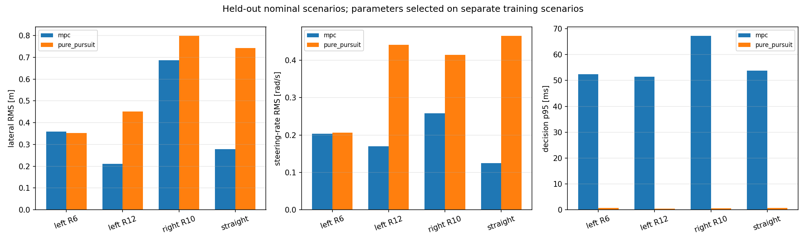
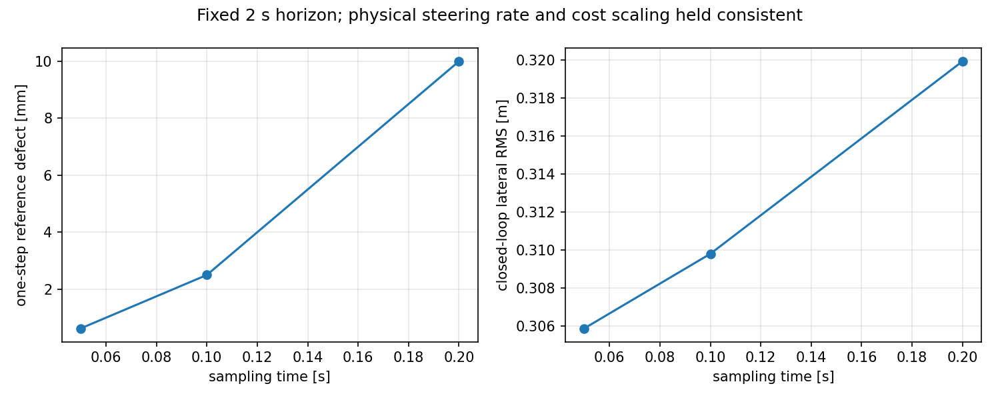

# Controller comparison and sensitivity experiments

Generated from the checked-in JSON results on 2026-11-14. Reproduce with
`python experiments/06_benchmark.py` and `python experiments/07_sampling.py`.

## Protocol fixed before held-out evaluation

Both controllers receive four candidate parameter values and three training
scenarios: 12 training rollouts each. This equalises candidate evaluations,
not CPU time or the size of their possible tuning spaces. MPC candidates vary
N over 10, 20, 30, 40 with fixed Q/R/P/S. Pure-pursuit candidates vary path
look-ahead over 1.5, 2, 3, 4 m with a fixed speed-loop gain.

The selector minimises mean training lateral RMS; a candidate with any invalid
run is ineligible. Smoothness and timing do not enter that selector, so the
chosen configuration is not claimed to optimise their trade-off. Training is
separate from the four held-out scenarios. Parameters are then frozen across
all nominal and perturbed tests. No retries, scenario-specific tuning, or
exclusion of failed rows is allowed.

| Controller | Candidate | Eligible | Mean training RMS [m] |
|---|---|---|---|
| mpc | 10 | True | 0.2908 |
| mpc | 20 | True | 0.2598 |
| mpc | 30 | True | 0.2538 |
| mpc | 40 | True | 0.2525 |
| pure_pursuit | 1.5 | True | 0.5720 |
| pure_pursuit | 2.0 | True | 0.2379 |
| pure_pursuit | 3.0 | True | 0.2565 |
| pure_pursuit | 4.0 | True | 0.2826 |

Selected: MPC **N=40**, pure pursuit **look-ahead=2.0 m**.

## Held-out nominal scenarios

The tests change turning direction, radius (6, 10, 12 m or straight), speed
(1.5, 2.5, 3 m/s), lateral offset (0.8 or 1 m magnitude) and heading offset.
All run for 8 s. Full definitions are in `_benchmark.py` and the JSON protocol.
MPC tracks a time-indexed trajectory; pure pursuit uses geometric projection
and a speed loop. The common evaluation metric is lateral path error.

| Scenario | Controller | RMS [m] | Final error [m] | Rate RMS [rad/s] | Decision p95 [ms] |
|---|---|---|---|---|---|
| test_left_R6_slow | mpc | 0.3597 | 0.0179 | 0.2039 | 52.45 |
| test_left_R6_slow | pure_pursuit | 0.3519 | 0.0250 | 0.2060 | 0.71 |
| test_left_R12_fast | mpc | 0.2102 | 0.0008 | 0.1703 | 51.48 |
| test_left_R12_fast | pure_pursuit | 0.4515 | 0.3598 | 0.4418 | 0.47 |
| test_right_R10 | mpc | 0.6856 | 0.0050 | 0.2585 | 67.30 |
| test_right_R10 | pure_pursuit | 0.7990 | 0.0402 | 0.4142 | 0.60 |
| test_straight_fast | mpc | 0.2785 | 0.0002 | 0.1252 | 53.76 |
| test_straight_fast | pure_pursuit | 0.7425 | 0.3710 | 0.4657 | 0.69 |

| Controller | Mean scenario lateral RMS [m] | Mean scenario steering-rate RMS [rad/s] |
|---|---|---|
| mpc | 0.3835 | 0.1895 |
| pure_pursuit | 0.5862 | 0.3819 |

These are equal-weight means of the four scenario-level metrics, not a pooled
sample statistic. Per-scenario results should be inspected alongside averages.
One controller need not win every metric or every scenario.

## Model mismatch, delay and noisy measurements

Each frozen configuration is also tested with a plant wheelbase of 3.0 m
(controller assumes 2.5 m), an unmodelled one-step command delay (100 ms), and
zero-mean Gaussian observation noise. The noise standard deviations are
0.02 m, 0.02 m, 0.005 rad, 0.02 m/s for x, y, heading and speed. Seeds 7, 11,
19 are fixed and shared by both controllers. Perturbations are applied separately.
The scoring uses the true plant state, not noisy observations. Command and
applied-input constraints are checked separately, including initial steering
change from zero. This is a small sensitivity study, not a robustness proof.

| Condition | Controller | Valid runs | Mean RMS [m] | Mean rate RMS [rad/s] | Mean of run p95 [ms] | 100 ms misses |
|---|---|---|---|---|---|---|
| nominal | mpc | 4/4 | 0.3835 | 0.1895 | 56.25 | 4 |
| nominal | pure_pursuit | 4/4 | 0.5862 | 0.3819 | 0.62 | 0 |
| wheelbase_plus20pct | mpc | 4/4 | 0.4224 | 0.1836 | 69.51 | 4 |
| wheelbase_plus20pct | pure_pursuit | 4/4 | 0.6037 | 0.3648 | 0.33 | 0 |
| delay_100ms | mpc | 4/4 | 0.3971 | 0.2357 | 73.38 | 4 |
| delay_100ms | pure_pursuit | 4/4 | 1.1464 | 0.3664 | 0.45 | 0 |
| noise_seed7 | mpc | 4/4 | 0.3832 | 0.3030 | 72.87 | 4 |
| noise_seed7 | pure_pursuit | 4/4 | 0.6398 | 0.4069 | 0.43 | 0 |
| noise_seed11 | mpc | 4/4 | 0.3830 | 0.3241 | 74.55 | 4 |
| noise_seed11 | pure_pursuit | 4/4 | 0.6208 | 0.4131 | 0.30 | 0 |
| noise_seed19 | mpc | 4/4 | 0.3832 | 0.3320 | 72.53 | 4 |
| noise_seed19 | pure_pursuit | 4/4 | 0.5822 | 0.4187 | 0.37 | 0 |

There are 72 total rollouts (24 training,
48 test); 0 invalid runs.
A valid run means accepted finite control decisions and numerical constraint
excess no greater than 1e-6 in the quantity's own units. It does not mean small
tracking error or a met real-time deadline.

Timing measures the complete Python control decision, including solver result
validation, excluding controller construction, plant advancement and plotting.
The table averages per-run p95 values; it is not a pooled p95. The MPC test
runs had **24 decisions exceeding 100 ms**, with a maximum of
**402.47 ms** on this machine. Solver success therefore does not establish
real-time feasibility. No compute delay is fed back from these measured times;
the 100 ms delay experiment is a separate fixed-delay condition.

## Sampling time and reference consistency

The prediction horizon stays at 2 s: T=0.2, 0.1, 0.05 s maps to N=10, 20, 40.
The steering-rate limit stays at 0.5 rad/s. Relative to T=0.1 s, Q and R are
scaled by T/0.1; S is scaled by 0.1/T; P stays fixed. This keeps the corresponding
stage and input-rate cost scales comparable. The scenario is the R=8 m arc,
2 m/s, -0.5 m initial offset, 8 s duration.

| T [s] | N | Max reference position defect [m] | Closed-loop RMS [m] | Decision p95 [ms] |
|---|---|---|---|---|
| 0.2 | 10 | 0.00999931 | 0.319920 | 5.18 |
| 0.1 | 20 | 0.00249996 | 0.309804 | 7.51 |
| 0.05 | 40 | 0.00062500 | 0.305884 | 40.49 |

The reference is sampled from a continuous circle, while the predictor uses
Euler. The defect is the position difference between one Euler step from a
reference state/input and the next reference state. Halving T reduces this
one-step defect by approximately four, while tracking error changes much less.
This is consistent with a discretisation contribution; it does not attribute
all residual error to Euler or prove general controller convergence.

## Remaining scope limits

Only straight and constant-curvature paths are covered, with three noise seeds
and a small fixed tuning grid. Curvature transitions, tyre slip, state estimation,
combined perturbations, arbitrary initial conditions, endpoint parking and
recursive feasibility are not established. Hard constraints and a terminal
weight alone do not constitute a stability or real-vehicle safety guarantee.

Data: [benchmark JSON](../outputs/06_benchmark.json),
[benchmark CSV](../outputs/06_benchmark.csv),
[sampling JSON](../outputs/07_sampling.json),
[sampling CSV](../outputs/07_sampling.csv).
